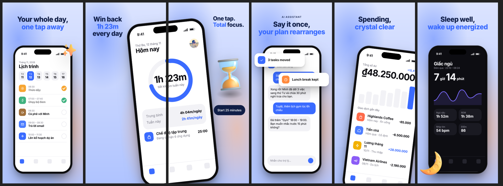
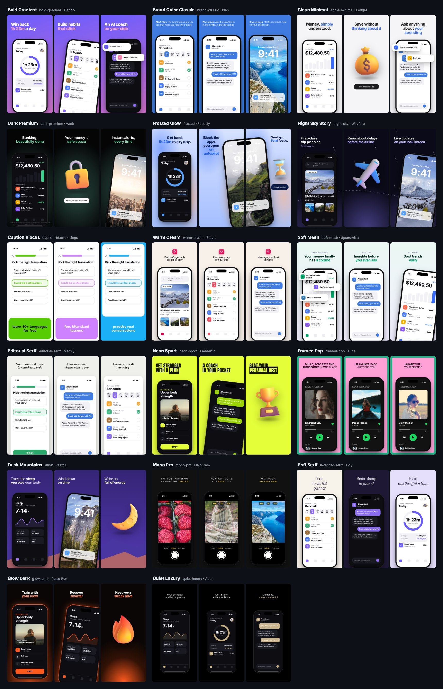

<h1 align="center">shotforge</h1>

<p align="center">
  <strong>Beautiful, store-ready App Store and Google Play screenshots from your real app screens.</strong><br>
  17 themes · 10 layouts · AI copywriting with Claude, OpenAI, Gemini or Grok · built for humans and AI agents
</p>

<p align="center">
  <a href="https://github.com/haevynx/shotforge/actions/workflows/ci.yml"></a>
  <a href="LICENSE"></a>
  
</p>

<p align="center"><a href="README.vi.md">Tiếng Việt</a></p>



Raw screenshots look flat and generic. Design tools take hours per locale. shotforge turns the screenshots you already have into a polished, on-brand set in one command, and keeps it in sync every time your UI changes.

- **Your real UI, untouched.** Screenshots are framed pixel-for-pixel, never redrawn, so the listing matches the app (Apple's review rules require that).
- **Designed after real store listings.** Themes and layouts are distilled from top apps: panoramic devices that span two slides, cards lifted out of the screen, award laurels, testimonials, big stats.
- **Every locale, perfectly typeset.** Headlines are real text, so accents and diacritics are always right. Add a language with one command.
- **AI where it helps.** A vision model reads your screens and writes benefit-led headlines, picks layouts and suggests a theme. Image models generate 3D objects, mascots and backgrounds in your brand colors.
- **Store-exact output.** 1320×2868 for the App Store and 1080×2160 for Google Play, exported as 24-bit PNG without an alpha channel.
- **Agent friendly.** Every command is non-interactive, configuration is plain JSON, and `render --json` returns the file list. Ask Claude Code, Codex or Cursor to "make App Store screenshots for this app".

## Quick start

Requires Node.js 20+ and Google Chrome (or run `npx playwright install chromium`).

```bash
npm install -g shotforge
```

```bash
mkdir store-assets && cd store-assets
shotforge capture ios home        # grab a screen from the iOS Simulator, with a clean 9:41 status bar
shotforge capture ios detail
shotforge init --name "Lumen" --primary "#3a6bff" --locales en,de
shotforge ai plan --write --apply-theme   # AI writes the copy, picks layouts, theme and colors
shotforge gallery                 # see your screens in all 17 themes
shotforge render                  # → out/<target>/<locale>/01.png …
```

No AI key? Write the headlines yourself in `shotforge.json`. Everything else works offline except fonts and the optional 3D icon library.

## Themes



| Theme             | Feels like                                            | Fits                               |
| ----------------- | ----------------------------------------------------- | ---------------------------------- |
| `bold-gradient`   | Vivid brand gradient, big left-aligned headline       | Any app                            |
| `brand-classic`   | One brand color, small copy with a bold lead sentence | Productivity, tools, business apps |
| `apple-minimal`   | Near-white, crisp type, lots of whitespace            | Utilities, finance, SaaS, B2B      |
| `dark-premium`    | Black with a soft glow, legal small print             | Banking, investing, insurance      |
| `frosted`         | Frosted-glass backdrop, numbers that pop              | Productivity, wellness, AI         |
| `night-sky`       | Stars and a flight path across the whole set          | Travel, tracking                   |
| `caption-blocks`  | Frameless screen, headline in a color block           | Education, casual games            |
| `warm-cream`      | Warm cream, small 3D icon above a short caption       | Travel, marketplaces               |
| `soft-mesh`       | Light brand tint, kicker labels, callout cards        | Fintech, AI, health                |
| `editorial-serif` | Serif headline with italic keywords                   | Education, reading, healthcare     |
| `neon-sport`      | Loud accent and heavy uppercase type                  | Fitness, sports                    |
| `framed-pop`      | Thick poster frame, mixed weights                     | Music, entertainment               |
| `dusk`            | Purple sky with mountains across slides               | Sleep, meditation                  |
| `mono-pro`        | Matte black, tracked uppercase                        | Camera, pro tools                  |
| `lavender-serif`  | Large serif, alternating light and dark               | Planners, lifestyle                |
| `glow-dark`       | Brand glow from below, glowing device edge            | Sports, games, crypto              |
| `quiet-luxury`    | Pure black, small type, restraint                     | Premium health, wearables          |

Run `shotforge themes` for the full descriptions.

## Layouts

Good sets change composition from slide to slide. Pick a layout per slide:

| Layout     | What it does                                                    |
| ---------- | --------------------------------------------------------------- |
| `hero`     | Headline on top, large device bleeding off the bottom (default) |
| `tilted`   | Device tilted and offset for energy                             |
| `callouts` | Device plus up to 4 cards lifted out of the screen              |
| `caption`  | Frameless screen with the headline in a color block             |
| `awards`   | Laurels, rating and a press quote                               |
| `quote`    | A user testimonial with five stars                              |
| `object`   | No device, one big 3D object or asset                           |
| `stat`     | One huge number plus a device                                   |
| `duo`      | Two overlapping devices                                         |
| `span`     | Oversized device that crosses into the next slide               |

Only use `awards`, `quote` and `stat` with real data. Never invent ratings or testimonials.

## Configuration

`shotforge init` creates a `shotforge.json` with a `$schema`, so your editor autocompletes and validates it.

```jsonc
{
  "$schema": "https://unpkg.com/shotforge/schema.json",
  "app": {"name": "Lumen", "description": "Day planner with a focus timer and an AI assistant."},
  "theme": "frosted",
  "brand": {"primary": "#3a6bff", "accent": "#ff8a3d"},
  "locales": ["en", "de"],
  "targets": ["ios-6.9", "android-phone"],
  "slides": [
    {"layout": "hero", "screenshot": "shots/home.png", "title": {"en": "Your whole day,\n*one tap away*", "de": "Dein ganzer Tag,\n*mit einem Tipp*"}},
    {"layout": "span", "screenshot": "shots/focus.png", "title": "Win back\n*1h 23m*\nevery day"},
    {"layout": "object", "asset": "fluent:Hourglass done", "title": "One tap.\n*Total* focus.", "subtitle": "Start 25 minutes"},
  ],
}
```

- `*word*` highlights a keyword, `**phrase**` makes it bold, `\n` breaks the line.
- Any text field is a string or a per-locale map. `screenshot` can be per-locale too.
- Assets accept a file path, `fluent:<Name>` (Microsoft Fluent 3D icons, MIT) or `peep:<seed>` (Notionists illustrations, CC0).

See [docs/configuration.md](docs/configuration.md) for every field, and [examples/lumen](examples/lumen) for a complete project.

## Commands

| Command                        | Description                                                               |
| ------------------------------ | ------------------------------------------------------------------------- |
| `init`                         | Create `shotforge.json`, using any screenshots already in `shots/`        |
| `capture ios\|android <name>`  | Capture from the Simulator or an emulator, with a clean status bar        |
| `preview`                      | Render one target and locale, then open a preview page                    |
| `gallery`                      | Render your screens in every theme to compare                             |
| `render`                       | Export every target and locale (`--format png\|jpg`, `--theme`, `--json`) |
| `ai plan`                      | Write headlines, pick layouts, suggest a theme and colors                 |
| `ai translate --to de,ja`      | Translate all copy and add the locales                                    |
| `ai asset "<subject>"`         | Generate a 3D object, mascot, illustration or background                  |
| `assets <query>`               | Search the free Fluent 3D icon library                                    |
| `keys set\|list\|remove`       | Manage API keys                                                           |
| `themes`, `layouts`, `targets` | List the catalogs                                                         |

## Export sizes

| Target          | Pixels      | Notes                     |
| --------------- | ----------- | ------------------------- |
| `ios-6.9`       | 1320 × 2868 | Required by the App Store |
| `ios-6.5`       | 1284 × 2778 |                           |
| `android-phone` | 1080 × 2160 | Google Play phone         |

## AI providers

```bash
shotforge keys set claude     # prompts without echoing; or set the env var below
shotforge keys list
```

| Provider | Env var             | Default text model | Default image model                    |
| -------- | ------------------- | ------------------ | -------------------------------------- |
| `claude` | `ANTHROPIC_API_KEY` | `claude-opus-5-5`  | —                                      |
| `openai` | `OPENAI_API_KEY`    | `gpt-5`            | `gpt-image-1` (transparent background) |
| `gemini` | `GEMINI_API_KEY`    | `gemini-2.5-pro`   | `gemini-2.5-flash-image`               |
| `grok`   | `XAI_API_KEY`       | `grok-4`           | `grok-2-image`                         |

Override the model with `--model` or in the config: `"ai": {"text": {"provider": "gemini", "model": "..."}}`. Keys are stored in `~/.config/shotforge/credentials.json` (mode 600) and only ever sent to the matching provider.

## Using shotforge from an AI agent

shotforge is designed to be driven by coding agents. A typical prompt:

> Make App Store and Google Play screenshots for this app. Run it in the iOS Simulator, capture the 5 key screens with `shotforge capture`, write `shotforge.json` with benefit-led headlines in English and German, then `shotforge render --json`.

The agent writes the copy itself, so no AI key is needed for text.

## Development

```bash
git clone https://github.com/haevynx/shotforge.git
cd shotforge
npm install
npm test
npm run dev -- render -c examples/lumen/shotforge.json
```

See [CONTRIBUTING.md](CONTRIBUTING.md). New themes and layouts are very welcome.

## License

[MIT](LICENSE). Fluent Emoji © Microsoft, MIT. Notionists © Zoish, CC0, served by DiceBear. Not affiliated with Apple or Google.
