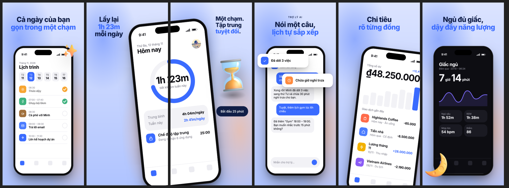

<h1 align="center">shotforge</h1>

<p align="center">
  <strong>Tạo bộ ảnh App Store và Google Play đẹp, đúng chuẩn store từ ảnh chụp màn hình thật của app.</strong><br>
  17 theme · 10 layout · AI viết chữ bằng Claude, OpenAI, Gemini hoặc Grok · dùng được cả bằng tay lẫn qua AI agent
</p>

<p align="center"><a href="README.md">English</a></p>



Ảnh chụp màn hình để nguyên trông đơn điệu và không có bản sắc. Tự thiết kế thì mỗi ngôn ngữ mất cả buổi. shotforge biến ảnh chụp bạn đang có thành một bộ ảnh chỉn chu, đúng màu thương hiệu, chỉ bằng một lệnh. Khi giao diện app thay đổi, chạy lại lệnh là bộ ảnh được cập nhật.

- **Giữ nguyên giao diện thật.** Ảnh chụp được đặt vào khung máy nguyên từng pixel, không vẽ lại, nên khớp với app thật đúng như quy định duyệt app của Apple.
- **Học từ ảnh store thật.** Theme và layout được rút ra từ các app hàng đầu: máy vắt liền qua hai ảnh, thẻ giao diện nhấc ra khỏi màn hình, vòng nguyệt quế giải thưởng, lời chứng thực, con số lớn.
- **Mọi ngôn ngữ đều chuẩn.** Tiêu đề là chữ thật nên dấu tiếng Việt luôn đúng. Thêm một ngôn ngữ chỉ bằng một lệnh.
- **AI đúng chỗ.** Model đọc ảnh chụp, viết tiêu đề theo lợi ích, chọn layout và gợi ý theme. Model tạo ảnh vẽ vật thể 3D, linh vật, nền theo màu thương hiệu.
- **Đúng kích thước store.** 1320×2868 cho App Store, 1080×2160 cho Google Play, xuất PNG 24-bit không có kênh alpha.
- **Hợp với AI agent.** Mọi lệnh chạy không cần tương tác, cấu hình là JSON, `render --json` trả về danh sách file.

## Bắt đầu nhanh

Cần Node.js 20 trở lên và Google Chrome (hoặc chạy `npx playwright install chromium`).

```bash
npm install -g shotforge
```

```bash
mkdir store-assets && cd store-assets
shotforge capture ios home        # chụp từ iOS Simulator, thanh trạng thái 9:41 sạch sẵn
shotforge capture ios detail
shotforge init --name "Lumen" --primary "#3a6bff" --locales vi,en
shotforge ai plan --write --apply-theme   # AI viết chữ, chọn layout, theme và màu
shotforge gallery                 # xem ảnh của bạn với cả 17 theme
shotforge render                  # → out/<target>/<ngôn ngữ>/01.png …
```

Không có key AI? Tự viết tiêu đề trong `shotforge.json` là được. Mọi thứ khác chạy offline, trừ font chữ và thư viện icon 3D (không bắt buộc).

## Cấu hình

```jsonc
{
  "$schema": "https://unpkg.com/shotforge/schema.json",
  "app": {"name": "Lumen", "description": "App lập kế hoạch ngày có hẹn giờ tập trung và trợ lý AI."},
  "theme": "frosted",
  "brand": {"primary": "#3a6bff", "accent": "#ff8a3d"},
  "locales": ["vi", "en"],
  "targets": ["ios-6.9", "android-phone"],
  "slides": [
    {"layout": "hero", "screenshot": "shots/home.png", "title": {"vi": "Cả ngày của bạn\n*gọn trong một chạm*", "en": "Your whole day,\n*one tap away*"}},
    {"layout": "span", "screenshot": "shots/focus.png", "title": "Lấy lại\n*1h 23m*\nmỗi ngày"},
    {"layout": "object", "asset": "fluent:Hourglass done", "title": "Một chạm.\nTập trung *tuyệt đối*.", "subtitle": "Bắt đầu 25 phút"},
  ],
}
```

- `*từ*` để tô màu từ khoá, `**cụm từ**` để in đậm, `\n` để xuống dòng.
- Mọi trường chữ có thể là một chuỗi, hoặc map theo ngôn ngữ.
- Tài sản đồ hoạ nhận đường dẫn file, `fluent:<Tên>` (icon 3D Microsoft Fluent, MIT) hoặc `peep:<seed>` (minh hoạ Notionists, CC0).
- Chỉ dùng layout `awards`, `quote`, `stat` khi có dữ liệu thật. Không bịa điểm đánh giá hay lời chứng thực.

Xem đầy đủ trong [docs/configuration.md](docs/configuration.md), danh sách theme, layout và lệnh trong [README tiếng Anh](README.md).

## AI

```bash
shotforge keys set claude     # nhập ẩn; hoặc đặt ANTHROPIC_API_KEY / OPENAI_API_KEY / GEMINI_API_KEY / XAI_API_KEY
shotforge ai plan --write
shotforge ai translate --to en,ja
shotforge ai asset "đồng hồ cát" --style 3d
```

Key được lưu ở `~/.config/shotforge/credentials.json` (quyền 600) và chỉ gửi tới đúng nhà cung cấp đó.

## Đóng góp

Xem [CONTRIBUTING.md](CONTRIBUTING.md). Rất hoan nghênh theme và layout mới.

## Giấy phép

[MIT](LICENSE).
